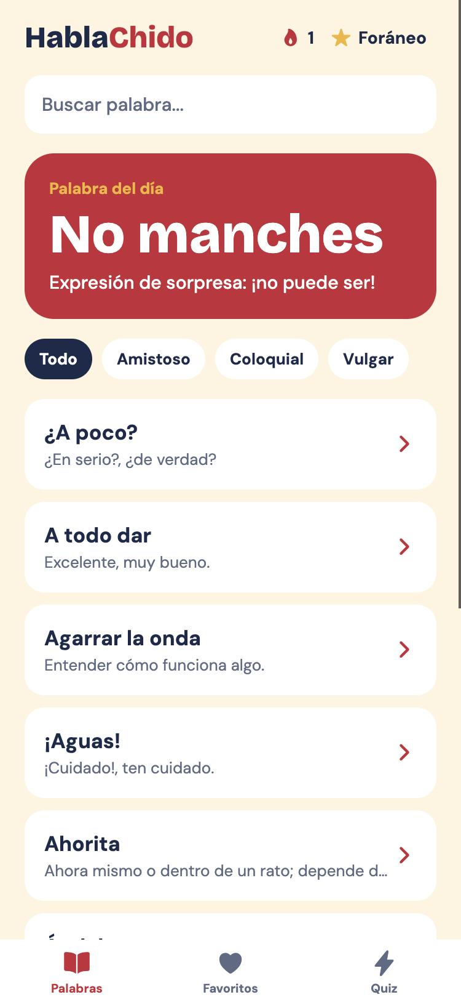
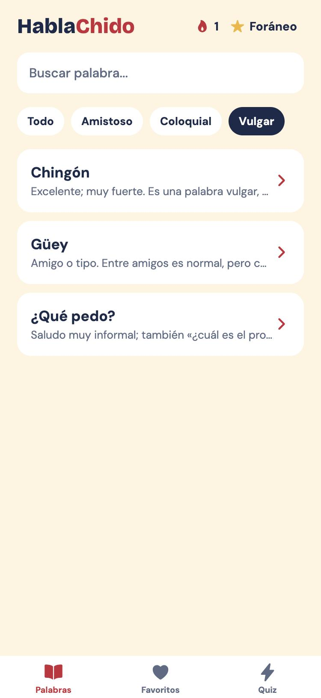
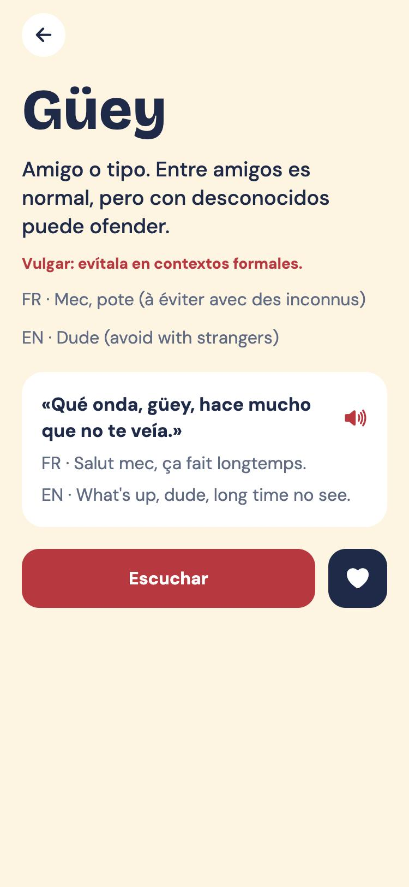
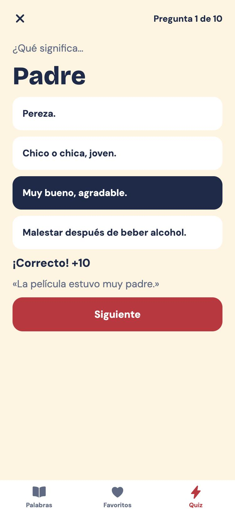

# Reporte de proyecto: HablaChido

Universidad La Salle México

APLICACIONES MÓVILES

Equipo GIGN: Aristide CORDONNIER · Mathis GIL · Oscar BUAT

23 de noviembre de 2026

Repositorio GitHub: https://github.com/aristocratte/ProyectoFinal

---

## 1. Objetivo y preparación

Diseñar, desarrollar y validar una aplicación móvil funcional con un framework visto en el curso, a partir de la propuesta del equipo. Elegimos React Native con Expo y construimos HablaChido, un diccionario de bolsillo del español coloquial de la Ciudad de México. En la propuesta se llamaba Diccionario Chilango. El nombre cambió durante el diseño, la idea no.

El problema lo vivimos los tres como estudiantes de intercambio. El español de clase no prepara para un "¿qué onda, güey?" en el metro, y casi ningún traductor dice si una expresión es amistosa o si conviene evitarla frente a un profesor. HablaChido reúne 54 expresiones, indica con quién se pueden usar, las pronuncia con la voz del teléfono y propone un quiz para practicar. Funciona sin internet.

### Material y equipo

| Recurso | Uso en el proyecto |
| --- | --- |
| Expo SDK 58 (expo 58.0.26) | Ejecución del proyecto y módulos del teléfono |
| React Native 0.88.1 y React 19.3.0 | Componentes de la interfaz y estado |
| Expo Router 58.0.32 | Pestañas y ficha de cada palabra |
| expo-speech 58.0.4 | Pronunciación con la voz es-MX del dispositivo |
| AsyncStorage 2.2.0 | Favoritos, puntos y racha guardados en el teléfono |
| TypeScript 6.0.3 | Tipos de los datos y revisión del código |
| Expo Go | Prueba en teléfono sin compilar la app |
| Navegador con Expo Web a 375 × 812 px | Pruebas de interfaz y capturas del reporte |

Las versiones salen de `package.json` y de los paquetes instalados. Expo SDK 58 fija la versión de React Native compatible, así que no mezclamos paquetes de otras versiones.

### Alcance comprometido

La propuesta fijó lo mínimo que debía hacer el prototipo: unas 50 expresiones en un archivo JSON local, búsqueda, filtro por nivel de formalidad, una ficha con significado, ejemplo y traducción al francés y al inglés, audio de pronunciación, favoritos guardados y un quiz de 10 preguntas con puntaje. También descartaba APIs de pago, servicios de terceros e inteligencia artificial dentro de la app. La sección 4 revisa cada punto.

---

## 2. Marco teórico

### React Native y Expo

React Native permite escribir la interfaz de una app con componentes de JavaScript o TypeScript. Cada componente, como `View`, `Text` o `Pressable`, se convierte en un elemento nativo de Android o de iOS. Expo agrega herramientas y módulos listos para usar. Con Expo Go el proyecto se abre en un teléfono escaneando un código QR, sin compilar nada.

Expo Go tiene un límite: solo incluye los módulos nativos que trae de fábrica. Una librería con código nativo propio exige un *development build*, es decir, compilar una versión propia de la app. Esa diferencia pesó en varias decisiones del proyecto, como se explica en la sección 5.

### Componentes y estado

Un componente es una función que devuelve lo que se ve en pantalla. El estado es la información que cambia mientras se usa la app: el texto buscado, la pregunta actual del quiz o la opción elegida. `useState` guarda un valor y da una función para cambiarlo. Cuando se llama a esa función, React vuelve a dibujar el componente con el valor nuevo (React, s. f.). Para la lista de palabras usamos `FlatList`, que solo dibuja las filas visibles.

### Navegación con Expo Router

Expo Router crea las rutas a partir de los archivos de la carpeta `app` (Expo, s. f.-b). Un archivo `_layout.tsx` define cómo se agrupan las pantallas. En HablaChido, `(tabs)/_layout.tsx` crea la barra inferior con Palabras, Favoritos y Quiz. El archivo `palabra/[id].tsx` es una ruta dinámica: el `[id]` del nombre recibe el identificador de la palabra que se abre.

### Estado compartido con Context

Algunos datos los usan varias pantallas. Un favorito se marca en la ficha y se muestra en otra pestaña. Pasarlo de componente en componente sería pesado, así que usamos un Context de React. `createContext` crea el canal, un componente `Provider` pone los valores en él y cualquier pantalla los lee con `useContext`.

### Persistencia local

Las palabras viven en `data/palabras.json`, que se empaqueta con la app. Lo que cambia con el uso, como los favoritos, los puntos y la racha, se guarda con AsyncStorage. Es un almacenamiento de clave y valor que solo acepta texto. Por eso las listas se convierten con `JSON.stringify` antes de guardarlas y con `JSON.parse` al leerlas. Sus funciones son asíncronas: devuelven una promesa que se espera con `await` (Expo, s. f.-a).

### Búsqueda sin acentos

Un extranjero escribe "orale", no "¡Órale!". El método `normalize('NFD')` separa cada letra de su acento, de modo que "Ó" queda como una "O" seguida de un acento suelto. Después, una expresión regular borra esos acentos y los signos ¿ y ¡. Con el texto en minúsculas, la búsqueda compara letras simples.

### Síntesis de voz

`expo-speech` usa el motor de texto a voz del sistema operativo (Expo, s. f.-c). Le pedimos el idioma `es-MX`. No necesita internet ni archivos de audio, pero el resultado depende de las voces instaladas en cada teléfono.

### Gamificación

Deterding et al. (2011) definen la gamificación como el uso de elementos de diseño de juegos en contextos que no son juegos. Puntos, niveles y rachas son los más comunes. Dan una meta visible y un motivo para volver. El riesgo es que la persona persiga el número en lugar de aprender, así que elegimos elementos simples y sin castigos.

### Registro del lenguaje

El registro es el grado de formalidad que pide una situación. La misma idea se dice distinto a un amigo que a un profesor. Clasificamos cada expresión como amistosa, coloquial o vulgar. Para alguien que acaba de llegar, saber que "güey" puede ofender a un desconocido importa tanto como saber qué significa.

### Pruebas con usuarios

Una prueba de usabilidad observa si la persona logra su objetivo, cuánto esfuerzo le cuesta y qué tan satisfecha queda. Nielsen (2000) muestra que unas cinco personas bastan para descubrir la mayoría de los problemas de una interfaz, siempre que se vuelva a probar después de corregir.

---

## 3. Desarrollo experimental

### Organización del proyecto

```
app/
  _layout.tsx           tipografías y datos guardados
  (tabs)/_layout.tsx    barra inferior
  (tabs)/index.tsx      lista, búsqueda, filtro y palabra del día
  (tabs)/favoritos.tsx  palabras guardadas
  (tabs)/quiz.tsx       quiz con puntos
  palabra/[id].tsx      ficha de una palabra
components/             PalabraFila y Boton
lib/palabras.ts         tipos y funciones de las palabras
lib/guardado.tsx        favoritos, puntos, racha y nivel
lib/theme.ts            colores, tipografías y estilos comunes
data/palabras.json      las 54 expresiones
```

Los datos están separados de las pantallas. Si se agrega una palabra al JSON, aparece en la lista, en la búsqueda y en el quiz sin tocar el código.

### Lista, búsqueda y filtro

La pantalla Palabras guarda dos estados: el texto buscado y el filtro elegido. Con ellos calcula la lista cada vez que se dibuja:

```
const resultados = palabras
  .filter((p) => filtro === 'todo' || p.registro === filtro)
  .filter((p) => normalizar(p.palabra).includes(texto)
              || normalizar(p.significado).includes(texto))
  .sort((a, b) => normalizar(a.palabra).localeCompare(normalizar(b.palabra)));
```

El primer filtro aplica el registro y el segundo la búsqueda. Si el texto está vacío, `includes('')` devuelve verdadero y pasan todas las palabras. La palabra del día se elige con el número del día del año, así cambia cada día y es la misma en todos los teléfonos. Solo aparece cuando no hay búsqueda ni filtro.

### Ficha y audio

La ficha lee el `id` de la ruta y busca la palabra. Muestra el significado, un consejo según el registro (en rojo si es vulgar), la traducción, un ejemplo traducido y dos botones: Escuchar y favorito. El audio cabe en dos líneas:

```
function escuchar(texto: string) {
  Speech.stop();
  Speech.speak(texto, { language: 'es-MX' });
}
```

`Speech.stop()` corta la lectura anterior. Sin esa línea, tocar dos veces el botón encima las voces.

### Datos guardados y gamificación

`lib/guardado.tsx` reúne todo lo que se guarda en el teléfono. Al abrir la app lee los favoritos, los puntos y la racha, y cada cambio se guarda en el momento:

```
function sumarPuntos(cuantos: number) {
  const nuevos = puntos + cuantos;
  setPuntos(nuevos);
  AsyncStorage.setItem('puntos', String(nuevos));
}
```

Cada respuesta correcta del quiz vale 10 puntos. El nivel no se guarda: se calcula a partir de los puntos.

| Puntos | Nivel |
| --- | --- |
| 0 a 99 | Turista |
| 100 a 299 | Foráneo |
| 300 a 599 | Chilango |
| 600 o más | Chilango de cepa |

La racha compara la fecha guardada con la de hoy. Si es la de ayer, suma un día. Si es más vieja, vuelve a 1. El nivel y la racha aparecen arriba de la pantalla Palabras.

### Quiz

`crearPreguntas` toma 10 palabras al azar y mezcla el significado de cada una con los de otras tres. El quiz no guarda una variable de fase. La pantalla se deduce de los datos: sin preguntas se ve el inicio, con el índice en 10 se ve el resultado y en cualquier otro caso se ve la pregunta actual. Así no puede mostrar el resultado con preguntas sin contestar.

Al responder, la opción correcta se pinta de azul marino y la elegida de rojo si estaba mal. Después aparecen el ejemplo de uso y el botón Siguiente. Al final, la app compara el nivel de antes y de después de la ronda para anunciar "¡Subiste a Chilango!" cuando corresponde.

### Simplificación del código

Queríamos que cualquier integrante pudiera explicar el código línea por línea en la demostración. Pasamos de 707 a 572 líneas. Juntamos favoritos y racha en un solo archivo, quitamos el mejor puntaje porque los puntos ya cumplen esa función y cambiamos los filtros por categoría temática por el filtro por registro que pedía la propuesta. El campo `categoria` sigue en el JSON para una versión futura.

### Errores encontrados

Las pruebas sacaron tres problemas. La app filtraba por categorías temáticas y no por formalidad, como decía la propuesta. El quiz agregaba un signo de interrogación a cada palabra, y las que ya lo tenían se veían como "¿Qué onda??". En la versión web, la palabra del día se cortaba ("No manc…") porque la reducción automática del texto solo existe en Android e iOS. Los tres están corregidos: ahora el título usa un tamaño fijo y puede ocupar dos líneas.

---

## 3.1. Capturas: lista y ficha

Las capturas se tomaron en Expo Web con el tamaño de un teléfono (375 × 812 puntos).

|  |  |  |
| --- | --- | --- |
| Figura 1. Inicio con palabra del día, racha y nivel. | Figura 2. Filtro por registro vulgar. | Figura 3. Ficha con consejo, traducción y ejemplo. |

La figura 1 junta lo que se ve al abrir la app: búsqueda, palabra del día y filtros. En la figura 2 solo quedan las tres expresiones vulgares. La figura 3 muestra el consejo en rojo, que es la versión simple del indicador "¿Lo puedo decir?" de la propuesta.

---

## 3.2. Capturas: favoritos y quiz

Para mostrar la subida de nivel, la cuenta de prueba empezó con 280 puntos.

|  |  |  |
| --- | --- | --- |
| Figura 4. Favoritos guardados en el teléfono. | Figura 5. Respuesta correcta con ejemplo de uso. | Figura 6. Resultado de 7/10 con subida de nivel. |

Los favoritos de la figura 4 siguieron ahí después de recargar la app. En la figura 5, la respuesta correcta suma 10 puntos y enseña la expresión en una frase. En la figura 6, los 70 puntos de la ronda llevaron la cuenta de 280 a 350 y el nivel pasó de Foráneo a Chilango.

---

## 4. Análisis de resultados

### Cumplimiento de la propuesta

| Requisito | Estado | Evidencia |
| --- | --- | --- |
| Unas 50 expresiones en un JSON local | Cumplido | 54 en `data/palabras.json`: 15 amistosas, 36 coloquiales y 3 vulgares |
| Búsqueda por palabra | Cumplido | Busca en la palabra y en el significado, sin acentos (figura 1) |
| Filtro por nivel de formalidad | Cumplido | Todo, Amistoso, Coloquial y Vulgar (figura 2) |
| Ficha con significado, ejemplo y traducción FR/EN | Cumplido | Figura 3 |
| Audio de pronunciación con expo-speech | Cumplido | Botón Escuchar y audio del ejemplo |
| Favoritos con AsyncStorage | Cumplido | Siguen ahí al recargar la app (figura 4) |
| Quiz de 10 preguntas con puntaje | Cumplido | Corrección inmediata y resultado (figuras 5 y 6) |
| Sin APIs de pago, servicios externos ni IA en la app | Cumplido | Solo datos locales y módulos de Expo |

También adelantamos tres ampliaciones que la propuesta dejaba para después: la palabra del día, una versión simple del indicador "¿Lo puedo decir?" y las rachas con niveles.

### Pruebas técnicas

| Prueba | Resultado | Qué demuestra |
| --- | --- | --- |
| TypeScript (`tsc --noEmit`) | 0 errores | Datos y funciones usan los tipos correctos |
| Expo Doctor | 20 de 20 revisiones | Dependencias compatibles con Expo SDK 58 |
| Paquetes de Metro para iOS y Android | Generados sin errores | El código compila para los dos sistemas |
| Recorrido completo en Expo Web | Todas las funciones respondieron | Búsqueda, filtro, ficha, favorito, quiz de 10 preguntas, subida de nivel y datos guardados al recargar |

Estas pruebas no sustituyen al teléfono. En la web no se escucha la voz es-MX de un dispositivo real, no se mide el uso con el dedo y el texto se comporta distinto, como mostró el título cortado. Esa parte corresponde a las pruebas con usuarios.

---

## 4.1. Pruebas con usuarios reales

Tres personas ajenas al equipo probaron la app y comentaron su experiencia de forma oral. No registramos tareas, tiempos ni errores, así que no presentamos cifras. La tabla resume lo que dijo cada una.

| Participante | Comentarios | Qué indica |
| --- | --- | --- |
| Persona 1 | Le gustó el diseño. La app le pareció muy simple de usar, clara y práctica, sin ninguna complejidad. | La decisión de simplificar se nota desde fuera |
| Persona 2 | Lo que más le gustó fue poder escuchar las palabras. La traducción le pareció precisa. | El audio y las traducciones FR/EN aportan valor real |
| Persona 3 | Opinión general parecida. Le habría gustado algo más gamificado y ve margen para mejorar la app. | Los puntos y niveles se quedan cortos como juego |

Las tres coincidieron en que la app es simple y clara.

### Qué dicen estas pruebas y qué no

Los comentarios confirman dos decisiones del proyecto. La interfaz sencilla funcionó: nadie la describió como complicada. Y el audio, que en el código son dos líneas, fue lo más valorado por una de las personas. La tercera opinión coincide con nuestra propia crítica de la gamificación: sumar puntos no basta para que se sienta como un juego. Las insignias, los retos diarios o el repaso espaciado de la sección 5 responden a esa petición.

Estos resultados tienen límites. Una opinión general no dice si cada persona logró buscar una palabra, usar el filtro o terminar el quiz sin ayuda, ni cuánto tardó. Nadie mencionó el filtro por registro, que es la función central de la propuesta, así que no sabemos si se entendió. Además, quien prueba la app de un conocido suele ser amable, y eso empuja los comentarios hacia lo positivo. Con tres personas y sin registro, la conclusión honesta es que la primera impresión es buena, pero la usabilidad todavía no está medida.

### Cómo repetiríamos la prueba

Siguiendo a Nielsen (2000), haríamos una segunda ronda con cinco personas ajenas al equipo y al grupo, cada una con el teléfono y sin explicación previa. Por cada tarea anotaríamos si la logró, cuánto tardó y si pidió ayuda. Al final, una calificación de 1 a 5 y una pregunta abierta: "¿Qué cambiarías?".

| Tarea | Qué mide |
| --- | --- |
| Buscar qué significa "neta" escribiéndolo sin acento | Si la búsqueda tolera errores reales |
| Encontrar las palabras que conviene evitar | Si el filtro por registro se entiende |
| Abrir una palabra y escuchar su pronunciación | Si el audio se encuentra y suena bien |
| Guardar una palabra y encontrarla después | Si el corazón y la pestaña Favoritos son claros |
| Terminar una ronda del quiz | Si la corrección y los puntos se entienden |

La lección para nosotros: escuchar opiniones sirve para saber qué gusta, pero sin anotar lo que pasa durante la prueba es difícil saber qué falla.

### Factores positivos y negativos

| Factor | Causa | Consecuencia | Respuesta |
| --- | --- | --- | --- |
| Funciona sin internet | Datos en JSON y voz del sistema | Sirve en el metro o sin datos móviles | Mantener todo local |
| Pronunciación variable | expo-speech usa las voces instaladas | Sin voz es-MX, el acento puede sonar de otro país | Explicar cómo instalar la voz y, a futuro, grabar audios |
| Pocas palabras vulgares | Solo 3 de 54 | El filtro Vulgar enseña poco sobre qué evitar | Ampliar ese contenido |
| Puntos que solo suben | Cada acierto suma y nada resta | Repetir el quiz sube de nivel aunque no se aprenda | Repaso espaciado (sección 5) |
| Distractores al azar | Se toman significados de cualquier palabra | Algunas preguntas son demasiado fáciles | Elegir distractores del mismo registro |
| Racha por apertura | Cuenta días en que se abre la app | Abrir sin estudiar mantiene la racha | Contar solo días con un quiz terminado |
| Datos solo en el teléfono | AsyncStorage es local | Al desinstalar se pierden favoritos y puntos | Respaldo opcional con cuenta |
| Código corto y directo | Un Context y pocos estados | Fácil de explicar y de cambiar | Conservar la estructura |

### Interpretación

El prototipo cumple todo lo que prometía la propuesta, y eso se debe en parte a que el alcance era pequeño. Un JSON local y módulos que ya trae Expo Go eliminaron los problemas típicos de red, cuentas y servidores. La consecuencia buena es una app que funciona sin conexión y se instala en segundos con un QR. La mala es que todo lo que depende del teléfono, como la voz, queda fuera de nuestro control.

Lo que más nos preocupa es la gamificación. Los puntos miden cuántas veces se juega, no cuánto se aprende. Alguien puede llegar a Chilango repitiendo el quiz con las mismas palabras fáciles. El código hace lo que debe; el problema está en el modelo. Funciona para motivar al principio, pero no dice si la persona ya distingue "padre" de "padrísimo". El repaso espaciado de la sección 5 ataca justo ese punto.

El contenido es la otra limitación real. Las 54 expresiones las escribimos nosotros, como hablantes no nativos que viven en la ciudad, y nadie con formación en lingüística las revisó. Un error en el registro, como marcar como amistosa una expresión que ofende, tendría más consecuencias que cualquier error de interfaz.

---

## 5. Mejoras a futuro

### Limitaciones del prototipo

El diccionario tiene 54 expresiones escritas por el equipo, sin revisión de un especialista. La pronunciación depende de la voz de cada teléfono. No hay cuentas ni respaldo, así que los datos se pierden al desinstalar. Los puntos premian la repetición. Las pruebas con usuarios recogieron opiniones, pero no midieron tareas ni tiempos. No revisamos la app con un lector de pantalla ni hay pruebas automáticas. La interfaz solo está en español, aunque los usuarios principales son extranjeros.

### Pronunciación asistida

La propuesta mencionaba grabar la propia voz y compararla con el modelo. La opción gratuita más directa es `expo-speech-recognition`, que usa el reconocimiento de voz de iOS y de Android y acepta español de México. El flujo sería simple: la persona toca el micrófono, dice la palabra y la app compara el texto reconocido con la expresión, normalizado igual que en la búsqueda. La alternativa sin conexión es `whisper.rn`, que ejecuta el modelo Whisper en el teléfono.

Las dos exigen dejar Expo Go y compilar un *development build*. Por eso no entraron en el prototipo: la demostración depende de Expo Go. Hay tres problemas más. El reconocimiento de Apple y de Google puede enviar el audio a sus servidores, lo que contradice la promesa de no usar servicios externos, salvo que se active el modo en el dispositivo. Whisper agrega unos 75 MB de modelo y consume batería. Además, un reconocedor general puede no conocer palabras como "güey" y devolver "wey", así que cada entrada del JSON necesitaría variantes aceptadas.

### Repaso espaciado

Un sistema de cajas guarda cada palabra en una caja según cuántas veces se acertó. Si se falla, vuelve a la primera. El quiz elegiría más palabras de las primeras cajas. Bastaría con guardar en AsyncStorage un número de caja por palabra, y los puntos empezarían a reflejar lo aprendido y no solo lo jugado.

### Contenido y comunidad

El campo `categoria` ya está en los datos, así que explorar por tema (comida, transporte, fiesta) es casi inmediato. Sugerir y votar palabras exige un servidor, cuentas y moderación, porque un diccionario de jerga atrae contenido ofensivo y discriminatorio. También convendría descargar el diccionario actualizado sin publicar otra versión de la app, guardando una copia local para seguir funcionando sin conexión.

### Hacia una versión en producción

| Mejora | Requisito técnico | Esfuerzo | Riesgo principal |
| --- | --- | --- | --- |
| Pronunciación asistida | Development build, permisos de micrófono | Alto | Privacidad del audio |
| Repaso espaciado | Caja por palabra en AsyncStorage | Bajo | Ninguno relevante |
| Insignias y retos diarios | Lista de logros en AsyncStorage | Bajo | Premiar la repetición y no el aprendizaje |
| Palabra del día con aviso | Notificaciones locales | Bajo | Avisos que molesten |
| Revisión de contenido | Hablantes nativos o lingüistas | Medio | Registro mal clasificado |
| Accesibilidad | Etiquetas, tamaño de texto, contraste | Medio | Excluir a quien usa lector de pantalla |
| Pruebas automáticas | Jest para normalizar, nivel y racha | Bajo | Ninguno relevante |
| Publicación en tiendas | EAS Build y política de privacidad | Medio | Revisión de las tiendas |

Empezaríamos por el repaso espaciado y las pruebas automáticas: cuestan poco y mejoran lo que ya existe. La pronunciación asistida es la más vistosa, pero también la que más cambia la arquitectura y la que más preguntas de privacidad abre.

---

## 6. Conclusiones

### Conclusión del equipo

HablaChido nació de un problema que conocemos bien y terminó como una app pequeña que hace lo que prometía. Aprendimos que recortar también es diseñar: quitar funciones dejó un código que los tres podemos explicar. La gamificación motiva, pero hay que vigilar qué mide. Y una app que habla de lenguaje vulgar tiene que tratarlo con cuidado, porque etiquetar mal una palabra afecta a personas reales.

### Aristide Cordonnier

Me tocó escribir las expresiones, y fue más difícil de lo que pensaba. Decidir si "güey" es amistoso o vulgar no es técnico, depende de quién lo dice y a quién. Como ingeniero en cibernética me interesa que el quiz sea un ciclo de retroalimentación: respondes, ves el error y ajustas, como en los sistemas que estudió Wiener (1961). El teléfono es donde ese ciclo pasa todos los días, por eso las apps móviles importan tanto en nuestra carrera. Sobre la ética, aprendí que un diccionario también opina. Si no avisamos que una palabra ofende, la app puede meter en problemas a quien confía en ella.

### Mathis Gil

Yo trabajé la interfaz y la navegación. Para un ingeniero en cibernética, la pantalla es el canal de control entre la persona y la máquina, y si ese canal confunde, todo lo demás falla. Lo noté al ver el título cortado en la web: un detalle visual cambiaba lo que la persona entendía. En lo ético me quedo con la gamificación. Las rachas pueden volverse una trampa que te obliga a abrir la app por ansiedad. Por eso no pusimos castigos ni notificaciones insistentes. Una app debe ayudar a quien la usa, no exprimir su atención.

### Oscar Buat

Mi parte fue el audio, los favoritos y el almacenamiento. Me gustó ver el teléfono como un sistema con sensores y actuadores: la bocina habla con expo-speech y el micrófono podría escuchar en una versión futura. Eso es cibernética aplicada en algo que todos llevamos en el bolsillo. Lo ético aparece con los datos. Hoy todo se queda en el teléfono y no pedimos cuenta, y me parece la decisión correcta. Si agregamos reconocimiento de voz, la voz es un dato personal. Habría que pedir permiso claro y explicar a dónde va el audio antes de grabar nada.

---

## 7. Declaratoria de uso de inteligencia artificial generativa

El equipo declara un uso de inteligencia artificial generativa de nivel 2, conforme a la escala definida en el curso.

## 8. Entrega y demostración

El código está en https://github.com/aristocratte/ProyectoFinal, dentro de la carpeta `hablachido`. Para ejecutarlo se instala Node.js, se corre `npm install` y luego `npx expo start`. El código QR se escanea con Expo Go, con el teléfono y la computadora en la misma red. Si la red de la escuela bloquea la conexión, `npx expo start --tunnel` crea un túnel.

En la demostración seguimos el recorrido de las figuras: buscar "orale" sin acento, filtrar las palabras vulgares, abrir "Güey", escucharla y guardarla, revisar Favoritos y terminar una ronda del quiz para ver los puntos y el nivel.

---

## 9. Referencias

Deterding, S., Dixon, D., Khaled, R., y Nacke, L. (2011). From game design elements to gamefulness: Defining "gamification". En *Proceedings of the 15th International Academic MindTrek Conference: Envisioning Future Media Environments* (pp. 9-15). ACM. https://doi.org/10.1145/2181037.2181040

Expo. (s. f.-a). *@react-native-async-storage/async-storage*. https://docs.expo.dev/versions/latest/sdk/async-storage/

Expo. (s. f.-b). *Introduction to Expo Router*. https://docs.expo.dev/router/introduction/

Expo. (s. f.-c). *Speech*. https://docs.expo.dev/versions/latest/sdk/speech/

Nielsen, J. (2000, 18 de marzo). *Why you only need to test with 5 users*. Nielsen Norman Group. https://www.nngroup.com/articles/why-you-only-need-to-test-with-5-users/

React. (s. f.). *useState*. https://react.dev/reference/react/useState

Wiener, N. (1961). *Cybernetics: Or control and communication in the animal and the machine* (2.ª ed.). MIT Press.

Fuentes consultadas el 23 de noviembre de 2026.
